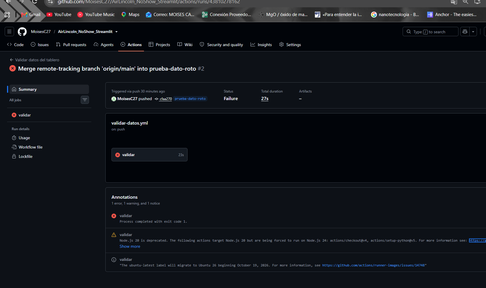
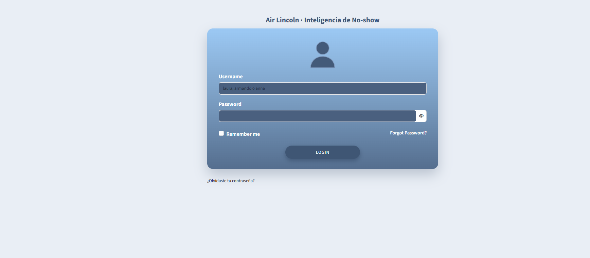

# Air Lincoln · Inteligencia de No-show (Streamlit)

Dashboard interactivo desarrollado con Python y Streamlit para analizar las ausencias de pasajeros (*No-Show*), consultar indicadores, explorar información de vuelos y apoyar la toma de decisiones.

## Ejecutar en Visual Studio Code (Windows)

Abre la carpeta del proyecto y ejecuta los siguientes comandos en la terminal:

```powershell
# Crear el entorno virtual (solo la primera vez)
python -m venv .venv

# Instalar dependencias
.venv\Scripts\python.exe -m pip install -r requirements.txt

# Ejecutar el dashboard
.venv\Scripts\python.exe -m streamlit run app.py
```

La primera carga puede tardar más porque se entrenan los cinco modelos. Después, los resultados pueden permanecer en caché.

## Estructura del proyecto

| Archivo o carpeta | Contenido |
|---|---|
| `app.py` | Entrada principal, navegación, selección de perfiles y manejo de errores |
| `core/` | Datos, modelos, simulador de sobreventa, validaciones y reglas de intervención |
| `ui/` | Componentes visuales, gráficas y configuración de la interfaz |
| `views/` | Vistas de Laura, Armando, Anna y acerca del producto |
| `data/` | Datos utilizados por el dashboard |
| `tests/` | Pruebas automatizadas |
| `scripts/` | Scripts de validación y utilidades |
| `investigacion/` | Investigación del ciclo de desarrollo con IA |
| `evidencias/` | Capturas y documentación de las mejoras |
| `ideas/` | Propuesta individual de mejora |
| `prompts/` | Registro de prompts utilizados |
| `.github/workflows/` | Configuración de GitHub Actions |
| `contrato-datos.md` | Reglas y características de las columnas publicadas |

## Inicio de sesión

La aplicación contempla diferentes perfiles de usuario con permisos y vistas específicas.

Para configurar la autenticación local, utiliza como referencia `.streamlit/secrets.toml.example` y completa los valores necesarios en `.streamlit/secrets.toml`.

**Importante:** el archivo `secrets.toml` contiene información privada y no debe publicarse en GitHub.

Para una implementación en Streamlit Community Cloud, configura las credenciales desde *Settings → Secrets*.

## Contrato y validación de datos

El proyecto utiliza un contrato de datos para identificar los tipos esperados, la procedencia de las columnas, las unidades y las reglas aplicables a los valores faltantes.

El contrato se encuentra en [`contrato-datos.md`](contrato-datos.md).

La aplicación revisa los tipos antes de mostrar la información y presenta los resultados de la validación.

### Ejecutar las pruebas

```powershell
.venv\Scripts\python.exe scripts/validar_datos.py
.venv\Scripts\python.exe -m pytest -q
```

## Pipeline automático — Entregable 2

Se implementó GitHub Actions mediante `.github/workflows/validar-datos.yml`.

El pipeline se ejecuta cuando se realizan cambios mediante `push` o `pull_request` y efectúa dos comprobaciones:

1. Validación del archivo `data/AIRLINCOLNDATA2.csv` mediante `scripts/validar_datos.py`.
2. Ejecución de las pruebas automatizadas mediante `pytest`.

### Prueba exitosa

Se ejecutó el pipeline en la rama `main` utilizando los datos originales y se obtuvo un resultado exitoso.

### Prueba fallida intencional

Para comprobar que el pipeline puede rechazar información inválida, se creó la rama `prueba-dato-roto`.

Se modificó un valor de la columna `No_Show`, cambiando `0` por `abc`, y se ejecutó nuevamente la validación.

La ejecución terminó con estado fallido. La modificación de prueba no se incorporó a `main`, conservando los datos correctos en la rama principal.

**Evidencia de ejecución fallida:**

[Ver ejecución fallida en GitHub Actions](PEGAR_AQUI_LA_URL_REAL_DE_LA_EJECUCION)



La evidencia debe comprobar que el fallo corresponde a una violación del contrato de datos.

## Tabla y procedencia de la información

El dashboard presenta tablas que permiten consultar y ordenar la información.

La tabla de análisis de vuelos utiliza `column_order` para establecer el orden de las columnas y `hide_index=True` para ocultar el índice.

Además, distingue la procedencia de las cifras mediante etiquetas:

- **Dato:** información obtenida del archivo original.
- **Calculado:** resultados obtenidos mediante fórmulas o modelos.
- **Simulado:** resultados de escenarios definidos dentro de la aplicación.

Las columnas monetarias se configuran numéricamente y se presentan en pesos mexicanos (MXN).

## Investigación del ciclo de desarrollo con IA

Se documentó el ciclo de desarrollo descrito por Anthropic, incluyendo las etapas de planificación, diseño, construcción, pruebas, despliegue y mantenimiento.

También se identificaron oportunidades para incorporar verificaciones automáticas y mejorar el proceso de trabajo del equipo.

[Consultar investigación](investigacion/claude.md)

## Aportación individual

Durante esta semana se realizaron pequeñas correcciones en la organización y presentación del menú de opciones del dashboard.

El objetivo fue mejorar la navegación y facilitar el acceso a las diferentes secciones, sin modificar los cálculos ni los datos originales.

**Evidencia de las mejoras:**

[Consultar documentación del menú](evidencias/mejoras_menu.md)



## Propuesta individual de mejora

Se documentó una propuesta de mejora para complementar las funciones del dashboard y facilitar el análisis de No-Show.

[Consultar propuesta individual](ideas/A0166921.md)

## Repositorio

Proyecto académico desarrollado para el análisis de No-Show mediante Streamlit y herramientas de inteligencia artificial.