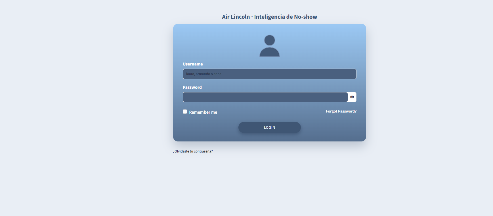

# Mejoras realizadas al menú de opciones

## Objetivo

Mejorar la navegación y la organización de las opciones del dashboard AIRLINCOLN para facilitar la consulta de información.

## Cambios realizados

Durante el desarrollo revisé el funcionamiento del menú de opciones y realicé ajustes para mejorar la experiencia de navegación dentro de la aplicación.

Estas modificaciones buscan que el usuario pueda acceder de manera más sencilla a las diferentes secciones del dashboard y encontrar la información relacionada con el análisis de No-Show.

## Justificación

El menú es importante porque permite organizar las funciones de la aplicación. Una navegación clara facilita el análisis de los datos y reduce la dificultad para localizar los indicadores y las gráficas.

## Aportación individual

Mi aportación durante esta semana consistió en realizar pequeñas correcciones en el menú de opciones del dashboard Air Lincoln.

Los ajustes se enfocaron en mejorar la organización y presentación de las opciones para facilitar la navegación entre las diferentes secciones.

Estas modificaciones no cambiaron los cálculos ni los datos del dashboard, pero ayudaron a mejorar la experiencia del usuario y a presentar la información de manera más clara.

## Evidencia de las mejoras

La siguiente captura muestra el menú de opciones del dashboard Air Lincoln después de las correcciones realizadas.

## Funcionamiento

El menú permite navegar entre las diferentes secciones del dashboard y consultar la información correspondiente al análisis de No-Show.

Durante esta semana realicé pequeñas correcciones relacionadas con la organización y presentación de sus opciones.

Para comprobar el funcionamiento, se ejecutó la aplicación en Streamlit y se revisó que la navegación continuara funcionando correctamente.

## Justificación de la aportación

Estos cambios buscan que el usuario identifique más fácilmente las opciones disponibles y pueda acceder a la información sin complicaciones.

La mejora se concentró en la navegación y presentación del menú, sin modificar los cálculos ni los datos utilizados en el análisis.

## Evidencia del código

Archivo o commit donde se implementaron las correcciones:

[Agregar enlace al archivo o commit correspondiente]
